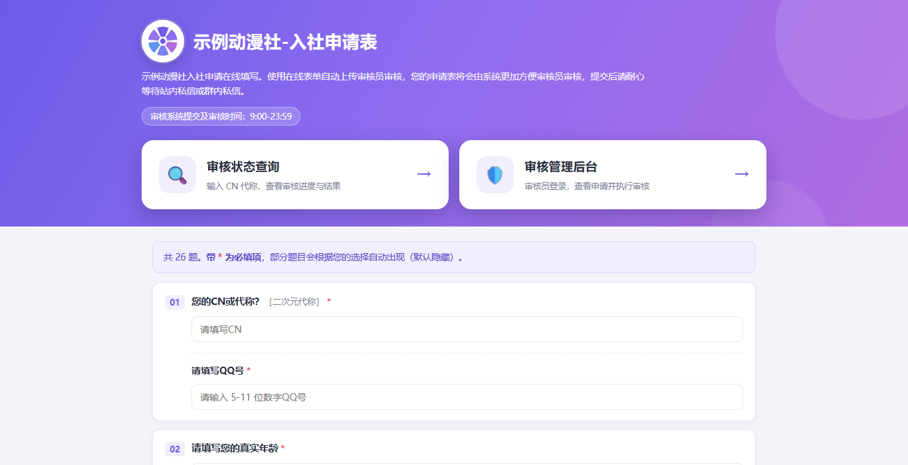
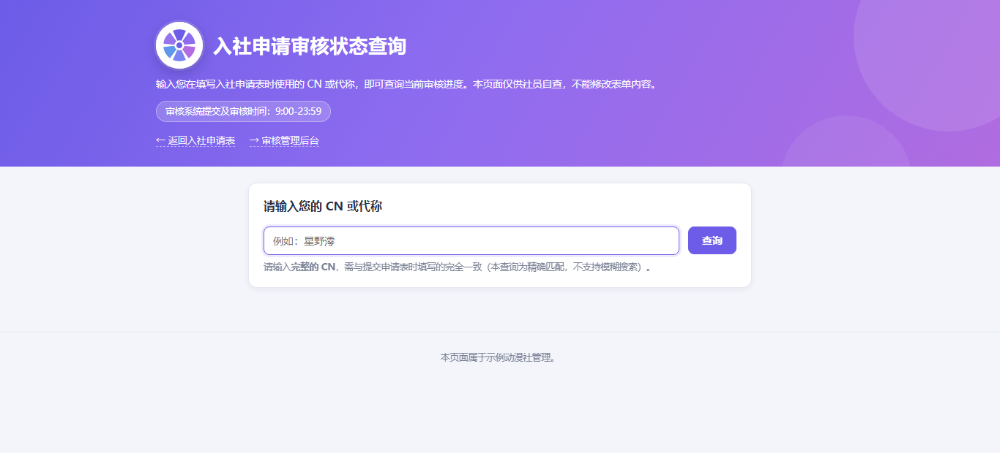
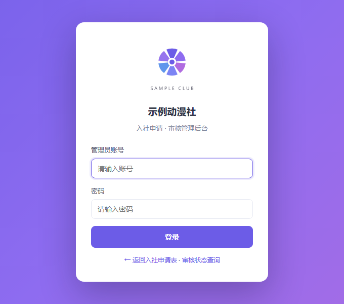
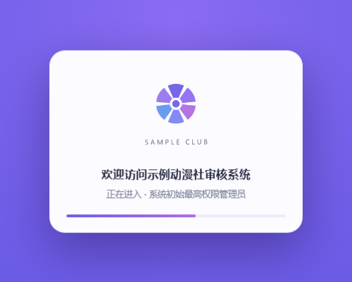
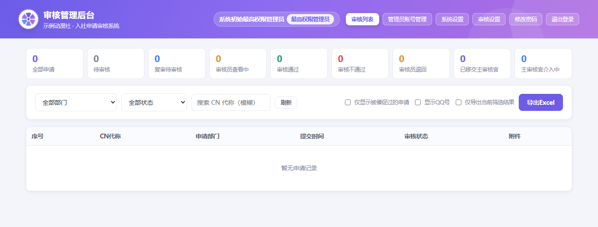

# 社团入社申请审核系统（Club Apply）

一套开箱即用的社团 / 组织招新报名与审核系统：**在线填表 → 附件上传 → 审核员审核 → 状态自助查询**。

纯 Node.js + 原生前端，**零构建、零数据库**（JSON 文件持久化，重启也不丢数据），
一条命令就能在本机跑起来，也能直接部署到云服务器长期使用。

> 本项目是一个**通用模板**：页面上的「示例动漫社」、占位社徽、示例部门都是占位内容，
> 请按 [自定义指南](#七自定义指南) 换成你自己的社团。仓库内不包含任何真实申请数据。

---

## 目录

1. [功能特性](#一功能特性)
2. [界面预览](#二界面预览)
3. [快速开始](#三快速开始)
4. [首次登录与账号体系](#四首次登录与账号体系)
5. [配置项](#五配置项环境变量)
6. [目录结构](#六目录结构)
7. [自定义指南](#七自定义指南)
8. [部署到云服务器](#八部署到云服务器)
9. [数据与备份](#九数据与备份)
10. [测试](#十测试)
11. [接口一览](#十一接口一览)
12. [安全设计](#十二安全设计)
13. [隐私与合规](#十三隐私与合规)
14. [许可证](#十四许可证)

---

## 一、功能特性

### 三个独立模块

| 模块 | 路径 | 说明 |
|---|---|---|
| 用户填写端 | `/` | 26 道入社问题，按选择动态显隐（如选「COS 部」才出现作品上传题） |
| 状态查询页 | `/status` | 申请人输入 CN 代称自助查进度、提交复审、催促审核 |
| 审核管理后台 | `/admin` | 审核员登录，看申请、审通过/不通过、退回、移交、导出 Excel |

### 申请表

- **26 道题**，必填/选填、单行/多行/单选/数字/图片上传/音频上传
- **条件联动**：第 8 题选「有经验」才出现第 9 题；第 11 题选「是」才出现第 12 题；
  第 13 题选部门才出现对应的作品题（14~21 题），无需资料的部门（如「宣传部」）不会出作品题
- **附件**：图片最多 6 张/题（jpg/png ≤10MB），音频 mp3/wav ≤30MB 且时长 ≥15 秒
- **QQ 号校验**：5~11 位纯数字
- **省份/城市**两级联动下拉（内置全国 34 个省级行政区）
- **草稿恢复**：本地缓存未提交内容，下次打开可恢复
- **移动端适配**：390px 无横向滚动，输入框字号 16px 避免 iOS 聚焦缩放

### 审核后台

- 列表筛选：部门 / 状态 / CN 模糊搜索 / 仅看被催促 / 是否显示 QQ
- 九种状态流转：待审核 → 查看中 → 通过 / 不通过 / 退回 → 复审 / 移交主审核官 / 介入改判
- **复审**：每份申请最多 2 次（初审被拒/被退回 1 次 + 复审被退回 1 次），提交时二次校验 QQ
- **催促审核**：申请人可催促，同一份 1 小时限 1 次，列表打标
- **审核介入**：主审核官可介入锁定某份申请并改判
- **账号体系**：超管 / 分管理员，5 项细粒度权限（审核、系统设置、封禁、介入、系统开启）
- **审核系统开关**：运行 / 暂停（可提交、有警戒横幅）/ 终止（前端禁用 + 后端 403）
- **Excel 导出**：作品图片作为 OOXML 绘图对象**内嵌进单元格**，打开就能看图
- **系统设置**：服务器信息、每日定时重启（可选）、重启审计日志
- 所有审核与设置操作均留痕（操作人 + 时间 + 理由）

---

## 二、界面预览

| 填写端 | 状态查询 | 后台登录 |
|---|---|---|
|  |  |  |

登录成功后有一段入场动画（约 1.5 秒；不想要可以删，见[自定义指南](#七自定义指南)）：



审核后台：



---

## 三、快速开始

**要求**：Node.js ≥ 18（推荐 20 / 22 LTS）

```bash
# 1. 安装依赖（只有 exceljs 和 jimp 两个）
npm install

# 2. 启动
npm start          # 等同于 node server.js
```

打开 http://localhost:3000/

| 地址 | 说明 |
|---|---|
| http://localhost:3000/ | 入社申请表 |
| http://localhost:3000/status | 审核状态查询 |
| http://localhost:3000/admin | 审核管理后台 |

Windows 用户也可以双击 `start.bat`（首次会自动 `npm install` 并打开浏览器）。
想让同一局域网的手机访问，双击 `开放局域网访问.bat` 放行防火墙后，用电脑的局域网 IP 访问。

**想先看看效果？** 灌一批演示数据（不会清空已有数据）：

```bash
npm run seed      # 等同于 node tools/seed-demo.js
```

---

## 四、首次登录与账号体系

首次启动会自动创建**最高权限管理员**：

```
账号：admin
密码：默认 change-this-password（可用环境变量 ADMIN_PASS 覆盖）
```

> 登录后请立刻在右上角【修改密码】改掉它。
> 密码用 `scrypt` 加盐哈希存储，服务端不保存明文。

| 角色 | 能做什么 |
|---|---|
| `super` 最高权限管理员 | 全部功能；可管理账号、授予权限 |
| `sub` 分管理员（审核员） | 默认只有审核权限，可按项授权 |

5 项权限：`review` 审核、`system` 系统设置、`ban` 封禁账号、`intervene` 主审核官介入、`openSystem` 审核系统开关。

---

## 五、配置项（环境变量）

全部有默认值，一般只需要设置 `PORT` 与 `ADMIN_PASS`。

| 变量 | 默认 | 说明 |
|---|---|---|
| `PORT` | `3000` | 监听端口 |
| `HOST` | `0.0.0.0` | 监听地址（放 Nginx 后面建议 `127.0.0.1`） |
| `DATA_DIR` | `./data` | 数据目录（申请、账号、附件、密钥都在这里） |
| `ADMIN_USER` | `admin` | **首次初始化**的超管账号 |
| `ADMIN_PASS` | `change-this-password` | **首次初始化**的超管密码 |
| `TOKEN_TTL_HOURS` | `12` | 登录令牌有效期（小时） |
| `MAX_RESUBMITS` | `2` | 每份申请的复审次数上限 |
| `MAX_UPLOAD_TOTAL_MB` | `5120` | 上传总量上限（磁盘保护） |
| `MIN_FREE_DISK_MB` | `1024` | 剩余磁盘低于此值拒绝上传 |
| `UPLOAD_URL_TTL_HOURS` | `24` | 附件签名链接有效期 |
| `ADMIN_ASSET_TTL_HOURS` | `3` | 后台预览附件链接有效期 |
| `URGE_COOLDOWN_MINUTES` | `60` | 同一申请催促冷却 |
| `URGE_RATE_PER_MIN` | `10` | 单 IP 每分钟催促次数 |
| `REVIEW_HISTORY_MAX` | `50` | 审核设置变更记录保留条数 |
| `REBOOT_MODE` | `manual` | 重启脚本模式（`selftest` 只演练不真重启） |
| `REBOOT_CRON` | `0 0 * * *` | 每日定时重启时间 |
| `REBOOT_DELAY_SECONDS` | `8` | 点下重启后延迟几秒执行 |
| `REBOOT_COOLDOWN_MINUTES` | `5` | 重启冷却 |
| `REBOOT_CMD` | `/usr/local/bin/club-reboot.sh` | 重启脚本路径 |
| `REBOOT_SYSTEM_LOG` | `/var/log/club-reboot.log` | 重启系统日志 |

> `ADMIN_USER` / `ADMIN_PASS` **只在第一次创建超管时生效**；之后账号存在 `data/admins.json`。
> 忘记密码可以删掉 `data/admins.json` 重启（会重建所有账号，**申请数据不受影响**）。

---

## 六、目录结构

```
club-apply/
├── server.js                 # 服务端入口：路由、鉴权、限流、静态资源
├── lib/
│   ├── config.js             # 全部常量：部门 / 题目规则 / 状态 / 权限 / 环境变量
│   ├── store.js              # JSON 持久化（申请、账号）+ 内存索引
│   ├── validate.js           # 表单校验（含附件规则）
│   ├── auth.js               # scrypt 口令 + HMAC 签名令牌
│   ├── export-xlsx.js        # Excel 导出（图片内嵌）
│   ├── review-state.js       # 审核系统三态开关
│   ├── system.js             # 服务器信息 / 重启
│   ├── thumbs.js             # 缩略图
│   ├── audio-duration.js     # 音频时长检测
│   └── util.js
├── public/                   # 前端（原生 HTML/CSS/JS，无构建）
│   ├── index.html  status.html  admin.html
│   ├── css/style.css
│   ├── js/apply.js  status.js  admin.js  common.js  regions.js
│   └── img/                  # 占位社徽（替换成你自己的）
├── deploy/
│   ├── install-ubuntu.sh     # Ubuntu/Debian 一键部署
│   ├── club-apply.service    # systemd 单元参考
│   ├── nginx-club.conf       # Nginx 反代参考
│   └── club-reboot.{sh,cron,sudoers}  # 每日定时重启（可选）
├── tools/                    # 测试与工具脚本
└── data/                     # 运行时生成：申请、账号、附件、日志（不提交 git）
```

---

## 七、自定义指南

### 1. 改社团名称

全站文案里的「示例动漫社」是占位名，替换成你的社团即可：

```bash
# 先看看都在哪儿
grep -rn "示例动漫社" public lib server.js deploy

# 全局替换（Linux / macOS）
grep -rl "示例动漫社" public lib server.js deploy | xargs sed -i 's/示例动漫社/你的社团名/g'
```

涉及：三个页面的 `<title>` 与横幅标题、页脚、后台登录卡片、导出文件名、停用提示等。

### 2. 换社徽

`public/img/` 下是三张**占位图**，保持文件名直接覆盖即可：

| 文件 | 用在哪 | 建议 |
|---|---|---|
| `logo-mark.png` | 三个页面横幅标题左侧的圆形徽章、后台头部 | 方图，白底，256×256 以上 |
| `logo-full.png` | 后台登录卡片、登录入场动画 | 竖向 logo（徽章 + 社团名），白底 |
| `favicon.png` | 浏览器标签页图标 | 96×96 方图 |

> 圆形徽章是「白底方图 + CSS 圆形裁切」（`.brand-mark`），
> 所以**直接用白底方图**就行，不需要抠透明背景。

### 3. 改部门 / 题目

- 部门列表、作品要求：`lib/config.js` 里的 `DEPARTMENTS` 与 `WORK_RULES`
  - 只要**不写进 `WORK_RULES`**，这个部门就自动「不显示作品题 + 后端不校验附件」
- 性别选项：`GENDERS`
- 不通过理由预设：`REJECT_REASONS`
- 表单题目本身在 `public/index.html`（`.q` 结构）+ `public/js/apply.js`（联动与校验）+ `lib/validate.js`（服务端同名校验）

> 前后端校验**必须同时改**，否则会出现「前端能填、后端 400」或反过来的情况。

### 4. 改主题色

`public/css/style.css` 顶部 `:root` 里改 `--brand` / `--brand-2` 等变量即可，
横幅渐变在 `.banner` 的 `background` 里。

### 5. 去掉登录入场动画

删掉 `public/admin.html` 里的 `#welcomeOverlay`，或把 `public/js/admin.js` 登录成功分支中的
`await playWelcome();` 去掉。

---

## 八、部署到云服务器

### 方式 A：一键脚本（Ubuntu / Debian）

```bash
# 把项目传到服务器后，在项目根目录执行
sudo ADMIN_PASS='你的强密码' bash deploy/install-ubuntu.sh
```

脚本会自动：安装 Node.js（≥18）→ 建运行用户 `club-apply` → 复制到 `/opt/club-apply`
→ `npm install --omit=dev` → 写 systemd 服务并开机自启 → 放行防火墙 → 打印访问地址。

### 方式 B：手动（systemd）

```bash
sudo useradd -r -s /sbin/nologin -d /opt/club-apply club-apply
sudo mkdir -p /opt/club-apply && sudo cp -r . /opt/club-apply/
cd /opt/club-apply && sudo npm install --omit=dev
sudo tee /opt/club-apply/data/env >/dev/null <<'ENV'
PORT=3000
HOST=127.0.0.1
ADMIN_USER=admin
ADMIN_PASS=请改成你自己的强密码
ENV
sudo chmod 600 /opt/club-apply/data/env
sudo chown -R club-apply:club-apply /opt/club-apply

sudo cp deploy/club-apply.service /etc/systemd/system/
sudo systemctl daemon-reload && sudo systemctl enable --now club-apply
```

### 方式 C：Nginx 反代 + HTTPS

```bash
sudo cp deploy/nginx-club.conf /etc/nginx/conf.d/club.conf
sudo vim /etc/nginx/conf.d/club.conf      # 改 server_name 为你的域名 / 公网 IP
sudo nginx -t && sudo systemctl reload nginx
```

参考配置已经把 `client_max_body_size` 放到 40m（默认 1m 会导致图片上传报 413）。
上 HTTPS 用 certbot 或 acme.sh 都行；**没有域名**也可以给 IP 签证书。

### 可选：每日定时重启

```bash
sudo install -o root -g root -m 755 deploy/club-reboot.sh /usr/local/bin/club-reboot.sh
sudo install -o root -g root -m 440 deploy/club-reboot.sudoers /etc/sudoers.d/club-reboot
sudo install -o root -g root -m 644 deploy/club-reboot.cron /etc/cron.d/club-reboot
sudo systemctl restart cron

# 先自检（不会真重启）
sudo -u club-apply sudo -n /usr/local/bin/club-reboot.sh selftest ops
```

---

## 九、数据与备份

全部数据都在 `DATA_DIR`（默认 `./data`）：

```
data/
├── applications.json   # 申请（含审核结论）
├── admins.json         # 管理员账号（scrypt 哈希，不含明文密码）
├── review-state.json   # 审核系统开关状态与变更记录
├── reboot-log.json     # 重启审计
├── secret.key          # 令牌签名密钥（泄露 = 可伪造登录，务必保密）
├── uploads/            # 申请附件原图 / 音频
├── thumbs/             # 缩略图
└── server.log
```

备份就是打包整个 `data/`：

```bash
tar -czf club-backup-$(date +%F).tar.gz -C /opt/club-apply data
```

> `data/` 已在 `.gitignore` 里 —— **绝对不要提交**，里面是申请人的真实个人信息。

---

## 十、测试

仓库自带测试脚本（使用临时数据目录，不会碰你的 `data/`）：

```bash
node tools/review-state-test.js   # 审核开关状态机（无需启动服务器）
node tools/api-test.js            # 接口与权限
node tools/resubmit-test.js       # 复审
node tools/urge-test.js           # 催促
node tools/ban-expiry-test.js     # 封禁到期
node tools/system-test.js         # 系统设置 / 重启（selftest 模式）

# UI 端到端（需要本机装 Chrome 或 Edge，并改脚本里的 executablePath）
node tools/ui-test.js
```

---

## 十一、接口一览

| 方法 | 路径 | 鉴权 | 说明 |
|---|---|---|---|
| GET | `/api/health` | 无 | 健康检查（申请数 / 账号数） |
| GET | `/api/meta` | 无 | 部门、题目规则、性别等元数据 |
| GET | `/api/review-state` | 无 | 审核系统状态（前台横幅用） |
| GET | `/api/status-query?cn=` | 无（限流） | 按 CN 查审核进度 |
| POST | `/api/upload` | 无（限流） | 上传附件，返回临时 token |
| POST | `/api/applications` | 无（限流） | 提交申请（终止态返回 403） |
| POST | `/api/resubmit` | 无（限流） | 提交复审 |
| POST | `/api/urge` | 无（限流） | 催促审核 |
| POST | `/api/admin/login` | 无（限流） | 登录，返回 Bearer 令牌 |
| GET | `/api/admin/me` | 登录 | 当前账号与权限 |
| POST | `/api/admin/password` | 登录 | 修改自己的密码 |
| GET | `/api/applications` | 登录 + 审核权限 | 申请列表 |
| GET | `/api/export` | 登录 + 审核权限 | 导出 Excel |
| GET/POST | `/api/admins` | 超管 / 封禁权限 | 账号管理 |
| GET | `/api/system/info` | 系统设置权限 | 服务器信息 |
| POST | `/api/system/reboot` | 系统设置权限 | 重启服务器（5 分钟冷却） |
| GET/POST | `/api/review-state` | 系统开启权限 | 审核系统开关 |

---

## 十二、安全设计

- **口令**：scrypt 加盐，不存明文；登录接口按 IP 限流
- **令牌**：HMAC-SHA256 自包含令牌，密钥持久化在 `data/secret.key`，重启不掉线
- **鉴权**：每个管理接口都在服务端校验权限位，前端隐藏菜单只是体验，不是安全边界
- **附件**：访问走带有效期的签名链接，不可枚举
- **上传**：类型、大小、总容量、剩余磁盘多重校验
- **限流**：提交、查询、催促、登录分别限流，取 `X-Forwarded-For` 的**最右侧**值防伪造
- **状态查询**：精确匹配 CN，不做模糊搜索，避免被批量枚举

> 生产部署请务必：改掉默认密码、把 `data/` 权限设为 600、`HOST` 绑 127.0.0.1 由 Nginx 反代、
> 不要把 `secret.key` 或 `data/` 提交到任何仓库。

---

## 十三、隐私与合规

本系统会存储申请人的 **CN、QQ 号、真实年龄、身高、所在地、兴趣经历、作品照片 / 录音**，
属于个人信息（其中部分可能构成敏感个人信息）。

作为部署者，你需要自行确保：

- 在填表页明确告知信息用途、保存期限与联系方式（可按需在 `public/index.html` 顶部补充说明）
- 只收集审核所必需的信息，审核结束后按约定期限清理附件
- 不把 `data/` 目录、导出文件、备份上传到任何公开位置
- 遵守所在地区关于个人信息保护的相关法律法规

仓库本身**不包含任何真实申请数据**，`tools/seed-demo.js` 生成的均为虚构示例。

---

## 十四、许可证

[MIT](LICENSE) —— 可自由使用、修改、商用，保留版权声明即可。

> 仓库中的「示例动漫社」名称与占位图形仅作演示，不代表任何真实社团；
> 如果你替换成自己的社团名称与社徽，该名称/标识的品牌权利由你自行负责。
